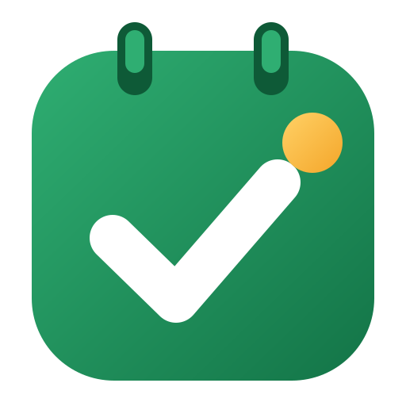

# My To-Do : Daily Planner

A native Windows to-do list, calendar with time blocking, reminders and work diary. Everything stays on your PC; optional Google sign-in (version 1.1.0.0) syncs only to a hidden app folder in your own Google Drive.

- **Platform:** Windows 10 1809+ and Windows 11, x64 and ARM64
- **Stack:** C#, .NET 10, WinUI 3 (Windows App SDK 2.x), SQLite, MSIX
- **Distribution:** Microsoft Store, free
- **Status:** 1.0.0.0 source complete, not yet built; see [completion status](docs/development-plan.md#completion-status)

## Features (1.0.0.0)

- **Tasks:** lists, tags, subtasks, priorities P1–P4, repeating tasks, smart views (Today, Upcoming, Overdue, No date, Completed, Archive), drag reorder, undo
- **Quick add from anywhere:** global shortcut, natural-language parsing ("Prepare sprint demo fri 10am p2 #work")
- **Calendar:** day, work week, week and month views; drag a task onto the calendar to block time; move and resize in 15-minute steps; overlap warning; repeating events with "this / following / all" edits
- **Reminders as Windows notifications,** even when the app is closed: 1 hour, 30 minutes and 15 minutes before; 3:00 PM the day before and 9:00 AM on the day for date-only tasks; Snooze, Mark done, missed-reminder summary after sleep
- **Time tracking:** start/stop timer, manual entries, time from completed blocks
- **Attachments** up to 10 MB per file
- **Diary:** one rich-text entry per day with the day's tasks, meetings and an end-of-day summary
- **Insights:** weekly tasks completed vs time spent, by list and tag, 8-week trend, CSV export
- **Search** across tasks, archive, events, diary and file names
- **Windows integration:** tray icon, launch at startup, jump list, light/dark/system theme, Mica on Windows 11, full keyboard shortcuts
- **Your data:** JSON and .ics export; no network connections in 1.0.0.0

Version 1.1.0.0 adds optional Google sign-in, sync to Google Drive app data, restore after reinstall, and daily local backup and restore.

## Repository layout

| Path | Contents |
| --- | --- |
| `MyTodo.sln` | Visual Studio solution |
| `src/MyTodo.Core` | Models, settings defaults, recurrence engine, quick-add parser, reminder rules, insights, calendar layout, ICS export |
| `src/MyTodo.Data` | SQLite database, migrations, stores, change log, FTS5 search, JSON export |
| `src/MyTodo.App` | WinUI 3 app: windows, pages, calendar controls, reminders, tray, hotkey, startup task |
| `tests/MyTodo.Tests` | xUnit tests for Core and Data |
| `docs/requirements.md` | Requirements and implementation approach |
| `docs/development-plan.md` | Work breakdown, schedule, quality gates, completion status |
| `docs/build.md` | Build details and where each epic lives in the code |
| `designs/` | Screen designs for every screen in light and dark theme (open `designs/index.html`) |
| `store-assets/` | Store logo and the logo for Google's consent screen |
| `assets/app-icon.svg` | Master app icon |
| `PRIVACY.md` | Privacy policy |

## Build and run

1. Install Visual Studio 2022 17.12+ (or Visual Studio 2026) with the **WinUI application development** workload, and the .NET 10 SDK.
2. Open `MyTodo.sln`, set **MyTodo.App** as the startup project, choose **x64** and **Debug**, and press F5.
3. Run the tests from **Test › Run All Tests**.

If NuGet reports a missing package version, update it to the latest stable version in **Manage NuGet Packages**. See [docs/build.md](docs/build.md) for things to check first on a new PC and for Store submission.

> **No backup in 1.0.0.0.** Uninstalling the app deletes its data. Use Settings › Your data › Export JSON to keep a copy until 1.1.0.0.

## Designs

Open [`designs/index.html`](designs/index.html) in a browser to see every screen in light and dark theme. The pages render offline from the design sources in `designs/source/`. The designs also show 1.1.0.0 items such as the sync status in the title bar; 1.0.0.0 hides them.

## Privacy

No telemetry, analytics or ads, and no network connections in 1.0.0.0. Read the full [privacy policy](PRIVACY.md).

## License

Add a license of your choice (for example MIT) as `LICENSE` before publishing the repository.
