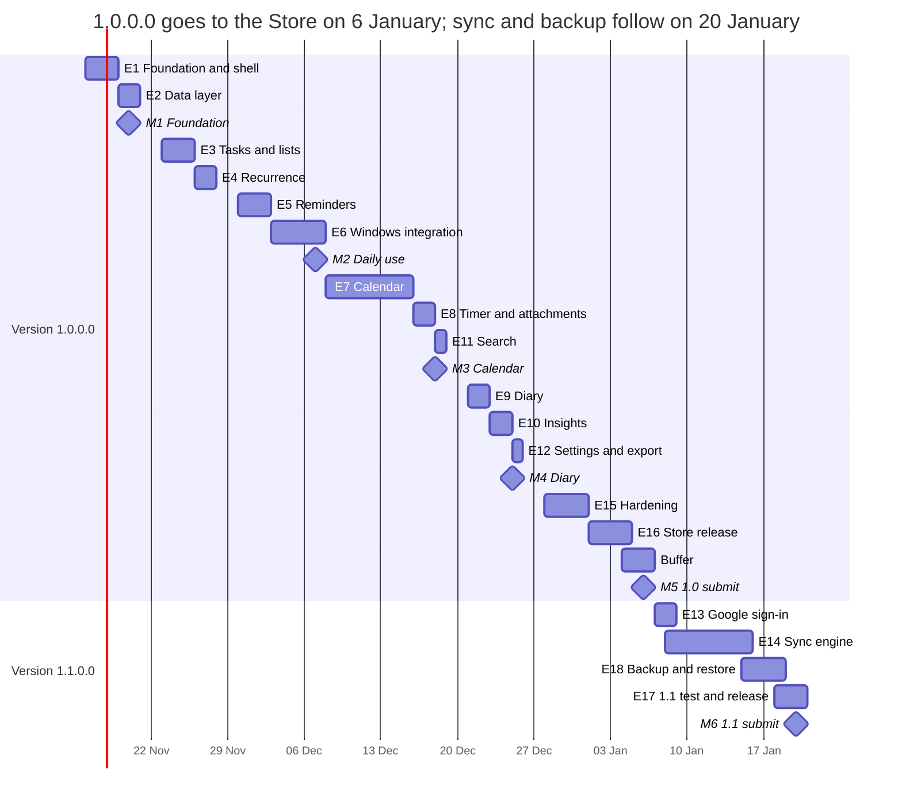

# My To-Do : Daily Planner — Development Plan

As of 13 November 2026

## 1. Summary

Version 1.0.0.0 holds every feature except Google sign-in, sync, and backup and restore, and takes about 37.5 developer-days: 35.5 days of build and test plus 2 days of buffer. Starting 16 November 2026, it goes to the Store on 6 January 2027 and should be live around 11 January 2027.

Version 1.1.0.0 adds Google sign-in, sync, and local backup and restore in about 9.5 more days, built while 1.0.0.0 is in certification. It goes to the Store on 20 January 2027 and should be live around 25 January 2027 (section 9).

That puts 1.0.0.0 about seven weeks after the 16 November target. Section 8 lays out the options for that date.

**Assumptions behind the estimates**

- One developer (you) working full-time, about 6 focused hours a day, 5 days a week.
- Claude generates the code for each epic from the requirements document and the screen designs; you build, run, test and review it. The estimates include that review and test time, which generated code does not remove.
- 1.0.0.0 scope is every Must and Should item in the requirements document except SYN-01–10 (sync) and SET-01–02 (backup and restore), which move to 1.1.0.0. Could items are included where they are small (ICS export, CSV export, jump list).
- 1.0.0.0 makes no network calls at all; its data model already keeps the IDs, timestamps and change log that 1.1.0.0 needs to sync existing data.
- No time off is planned. Holidays in late December move every later date by the same number of days.

## Completion status

As of 13 November 2026, the source for every 1.0.0.0 epic is written but has not yet been built; building, testing on Windows 10 and 11, and the Store release need your PC and accounts.

| Item | Version | Status | What's left |
| --- | --- | --- | --- |
| E1 Foundation and app shell | 1.0.0.0 | Code written, not built | First build in Visual Studio; fix compile errors |
| E2 Data layer | 1.0.0.0 | Code written, not built | Run the unit tests |
| E3 Tasks and lists | 1.0.0.0 | Code written, not built | Try against acceptance scenarios |
| E4 Recurrence engine | 1.0.0.0 | Code written, not built | Run the unit tests |
| E5 Reminders | 1.0.0.0 | Code written, not built | Check toast buttons with the app closed, on Windows 10 and 11 |
| E6 Windows integration and quick add | 1.0.0.0 | Code written, not built | Check whether Win+Shift+T can be registered |
| E7 Calendar | 1.0.0.0 | Code written, not built | Check drag, resize and drop at 60 fps |
| E8 Time tracking and attachments | 1.0.0.0 | Code written, not built | Try against acceptance scenarios |
| E9 Diary | 1.0.0.0 | Code written, not built | Try against acceptance scenarios |
| E10 Insights | 1.0.0.0 | Code written, not built | Check totals with a seeded week |
| E11 Search | 1.0.0.0 | Code written, not built | Check under 100 ms on 10,000 tasks |
| E12 Settings and export | 1.0.0.0 | Code written, not built | Try every setting |
| E15 Hardening | 1.0.0.0 | Needs your PC | Accessibility, performance and Windows 10 and 11 passes; unit tests already written |
| E16 Store release | 1.0.0.0 | In progress | Icons and package manifest done; reserve the name, associate with the Store, certify, submit |
| E13 Google sign-in | 1.1.0.0 | Not started | Starts after 1.0.0.0 submission |
| E14 Sync engine | 1.1.0.0 | Not started | Starts after E13 |
| E18 Backup and restore | 1.1.0.0 | Not started | Starts after 1.0.0.0 submission |
| E17 1.1.0.0 testing and release | 1.1.0.0 | Not started | Starts after E14 and E18 |
| Requirements document | Both | Done | — |
| Screen designs (light and dark) | Both | Done | — |
| Privacy policy text | Both | Done | Publish on your domain before 1.1.0.0 |
| Reserve the app name in Partner Center | 1.0.0.0 | Not started | Your Partner Center account |
| Domain, Google Cloud project and brand verification | 1.1.0.0 | Not started | Your domain and Google account |

## 2. Work breakdown

Fourteen epics make up 1.0.0.0 (35.5 days) and four make up 1.1.0.0 (9.5 days); the calendar (6 days) is the largest item in 1.0.0.0 and sync (5 days) in 1.1.0.0.

| # | Version | Epic | What it delivers | Requirements | Effort (dev-days) | Needs first |
| --- | --- | --- | --- | --- | --- | --- |
| E1 | 1.0.0.0 | Foundation and app shell | Solution and projects, DI, MVVM, logging, MSIX packaging, CI build; title bar, navigation pane, light/dark/system theme, Mica with Windows 10 fallback | WIN-04, WIN-05 | 3 | — |
| E2 | 1.0.0.0 | Data layer | SQLite schema with IDs, timestamps, tombstones and change log ready for 1.1.0.0 sync; migrations, repositories, FTS5 index | SET-05 (base), data model | 2 | E1 |
| E3 | 1.0.0.0 | Tasks and lists | Task and list CRUD, tags, subtasks, priorities, smart views, drag reorder, undo, archive job | TSK-01–08, TSK-10, TSK-11 | 3 | E2 |
| E4 | 1.0.0.0 | Recurrence engine | RRULE expansion for tasks and events, "this / following / all" edits, unit tests | TSK-05, CAL-06 | 2 | E2 |
| E5 | 1.0.0.0 | Reminders | Scheduled toasts, defaults (1 h, 30 min, 15 min; 3 PM day before and 9 AM for date-only), short-notice rule, snooze, Mark done, missed summary, sound | REM-01–10 | 3 | E3, E4 |
| E6 | 1.0.0.0 | Windows integration and quick add | Tray, startup task, global hotkey, single instance, close-to-tray, jump list, quick-add window with natural-language parser | WIN-01–03, WIN-06, WIN-07, TSK-07 | 3 | E3 |
| E7 | 1.0.0.0 | Calendar | Week and day timeline control, month view, drag/resize with 15-minute snap, drag from task pane, overlap warning, recurring edits, ICS export | CAL-01–10 | 6 | E3, E4 |
| E8 | 1.0.0.0 | Time tracking and attachments | Start/stop timer, manual entries, time from completed blocks; attachments copied, opened, removed, 10 MB limit | TSK-09, TSK-12, CAL-08 | 2 | E3, E7 |
| E9 | 1.0.0.0 | Diary | Rich text editor, day panel with tasks and meetings, end-of-day summary, mini calendar | DIA-01–04 | 2 | E3, E7 |
| E10 | 1.0.0.0 | Insights | Weekly completed vs time spent, per list and tag, 8-week trend, planned vs actual, CSV export | INS-01–05 | 2 | E8 |
| E11 | 1.0.0.0 | Search | Search box, grouped results, filters across tasks, archive, events, diary, file names | SET-05 | 1 | E2 |
| E12 | 1.0.0.0 | Settings and export | Settings page with all 1.0.0.0 defaults (no Account and sync or Backup sections); JSON and ICS export | SET-03, SET-04 | 1 | E5, E6 |
| E15 | 1.0.0.0 | Hardening | Accessibility pass, performance targets, Windows 10 and 11 testing, DST tests, check of zero network traffic, bug fixing | PRF-01–08, NFR | 4 | E1–E12 |
| E16 | 1.0.0.0 | Store release | Icon assets, screenshots, listing, certification kit, submission | — | 1.5 | E15 |
| | 1.0.0.0 | **Subtotal** | | | **35.5** | |
| E13 | 1.1.0.0 | Google sign-in | OAuth with PKCE and loopback, token in PasswordVault, sign out; Account and sync section added to Settings, sync status in the title bar and tray | SYN-01, SYN-10 | 1.5 | 1.0.0.0 |
| E14 | 1.1.0.0 | Sync engine | Push, pull, merge, diary conflict copies, attachments, compaction, interval and Sync now, restore after reinstall; first sign-in uploads existing 1.0.0.0 data | SYN-02–09 | 5 | E13 |
| E18 | 1.1.0.0 | Backup and restore | Daily backup to a folder you choose that survives uninstall, keeping 3 days; manual backup; restore, including on first run; Backup section in Settings | SET-01, SET-02 | 1 | 1.0.0.0 |
| E17 | 1.1.0.0 | 1.1.0.0 testing and release | Two-install sync tests, reinstall restore from Drive and from a backup file, Windows 10 and 11, privacy policy update, Store update submission | — | 2 | E14, E18 |
| | 1.1.0.0 | **Subtotal** | | | **9.5** | |

## 3. Schedule

1.0.0.0 runs from 16 November 2026 to submission on 6 January 2027; 1.1.0.0 starts the next day and is submitted on 20 January, while 1.0.0.0 is still in certification.

From M2 on 7 December the app is usable for your own daily work; the calendar arrives at M3 and 1.0.0.0 is complete at M5. The plan counts 25 December and 1 January as working days, so any time off moves later dates by the same amount.

## 4. Non-code track (runs alongside the build)

1.0.0.0 needs only the Store tasks; the domain and Google tasks are for 1.1.0.0 and must be done before sign-in work starts on 7 January.

| Task | For | Do by | Why then |
| --- | --- | --- | --- |
| Reserve "My To-Do : Daily Planner" in Partner Center | 1.0.0.0 | 20 Nov | Locks the name; the Store association is needed for MSIX packaging in E1 |
| Export Store icon sizes from the master SVG | 1.0.0.0 | 18 Dec | Needed for the package manifest |
| Buy a domain; publish a homepage and a privacy policy | 1.1.0.0 (optional for 1.0.0.0) | 18 Dec | 1.0.0.0 collects nothing, so the Store does not require a policy; Google does for 1.1.0.0 |
| Verify the domain in Google Search Console | 1.1.0.0 | 18 Dec | Required before Google brand verification |
| Create the Google Cloud project, enable the Drive API, set branding, Audience to Production, scopes `openid`, `email`, `drive.appdata`; export the 120 × 120 logo | 1.1.0.0 | 23 Dec | Needed for the OAuth client ID used in E13 |
| Create the Desktop OAuth client and submit brand verification | 1.1.0.0 | 23 Dec | Google estimates 2–3 business days; leaves margin over the holidays |
| Write the Store listing: description, features, search terms; take screenshots in light and dark | 1.0.0.0 | 4 Jan | Screenshots need the finished UI |
| Complete the age rating questionnaire and certification notes | 1.0.0.0 | 5 Jan | Last inputs before submission on 6 Jan |
| Update the privacy policy and the Store listing for sign-in, sync and backup | 1.1.0.0 | 19 Jan | Last inputs before the 1.1.0.0 submission on 20 Jan |

## 5. How each epic is built

Each epic runs the same six-step loop on its own Git branch, and it merges only when its tests pass on both Windows 10 and Windows 11.

1. **Brief:** you start the epic by naming it (for example "E5 Reminders"); Claude reads the requirement IDs, the data model and the screen designs for it.
2. **Generate:** Claude writes the code and its unit tests, in the solution structure (`MyTodo.App`, `MyTodo.Core`, `MyTodo.Data`, `MyTodo.Tests`, plus `MyTodo.Sync` in 1.1.0.0).
3. **Build and run:** you build in Visual Studio, run the tests, and try the feature against the epic's acceptance scenarios (section 6).
4. **Report:** you send back build errors, failing tests, or a screenshot of anything that looks or behaves wrong.
5. **Fix:** Claude corrects the code; steps 3 to 5 repeat until the epic is clean.
6. **Merge and tag:** merge to `main`, tag the build (for example `v0.5-reminders`), and note anything deferred.

Claude Code works directly in the repository and can run the build and tests itself, which shortens steps 3 to 5 compared with copying code from chat.

**Conventions for every epic**

- 1.0.0.0 makes no network calls: the `MyTodo.Sync` project is added only in 1.1.0.0, and a unit test fails the build if any other project references `HttpClient`.
- Every database change ships with a migration and a test that upgrades a copy of the previous schema, so 1.0.0.0 data upgrades cleanly to 1.1.0.0.
- Every user-facing string sits in a resource file, even though both versions are English only.

## 6. Quality gates

Each milestone closes only when its gate passes; from M2 on, you use the app for your own work every day, which is the best test of all.

| Milestone | Date | Epics | Gate: all of these pass |
| --- | --- | --- | --- |
| M1 Foundation | Fri 20 Nov | E1, E2 | App opens on Windows 10 and 11 in light, dark and system theme; data survives a restart and a crash; CI produces a signed MSIX |
| M2 Usable daily | Mon 7 Dec | E3–E6 | Toast fires with the app closed; 1 h / 30 min / 15 min and date-only reminders fire on time; short-notice rule works; snooze from the toast; Win+Shift+T opens quick add in under 200 ms |
| M3 Calendar | Fri 18 Dec | E7, E8, E11 | Drag a task to a slot creates a 30-minute block at 60 fps; overlap warning shows; timer survives closing the window; 12 MB file rejected; search returns in under 100 ms on 10,000 tasks |
| M4 Diary and insights | Fri 25 Dec | E9, E10, E12 | Diary entry saves and shows the day's tasks; Insights totals match a seeded week; every default in Settings applies; JSON and ICS exports open correctly |
| M5 1.0.0.0 submitted | Wed 6 Jan | E15, E16 | All 1.0.0.0 acceptance tests pass; performance targets PRF-01–08 met; Narrator and keyboard pass; zero network traffic; no backup, restore or sync controls visible; Windows App Certification Kit passes |
| M6 1.1.0.0 submitted | Wed 20 Jan | E13, E14, E18, E17 | Uninstall, reinstall, sign in: everything returns from Drive; two installs edited offline merge without loss; diary conflict keeps both versions; existing 1.0.0.0 data uploads on first sign-in; daily backup lands in the chosen folder with 3 days kept and survives uninstall; restore from a backup file returns everything including attachments; no traffic while signed out |

**Testing in every epic**

- Unit tests for logic (recurrence, parser, reminder rules, merge) run on every build.
- A seeded database with 10,000 tasks and 1,000 diary entries is used for every performance check.
- Each epic is tried on one Windows 10 and one Windows 11 machine (a VM is fine for Windows 10).

## 7. Release checklist

Tick the 1.0.0.0 boxes between 1 and 6 January and the 1.1.0.0 boxes by 20 January; each submission waits until its boxes are ticked.

**1.0.0.0: build**

- [ ] Version set to 1.0.0.0 in the manifest; Release build for x64 and ARM64 as one `.msixupload`
- [ ] Windows App Certification Kit passes on the final package
- [ ] Clean install, upgrade from the last test build, and uninstall all work
- [ ] App runs on Windows 10 (1809 or later) and Windows 11 from the installed package, not only from Visual Studio
- [ ] No Google sign-in, sync status or Sync now anywhere in the UI; network monitor shows no traffic

**1.0.0.0: Store listing**

- [ ] Pricing: free, all markets, public
- [ ] Category Productivity; "collects personal information" answered No
- [ ] Description, feature list and search terms written
- [ ] Screenshots in light and dark theme, 1366 × 768 or larger
- [ ] Store logo and all package icon sizes from the master icon
- [ ] Age rating questionnaire done
- [ ] Certification notes: no account needed; every feature works offline

**1.0.0.0: after submission**

- [ ] Certification report read; any failure fixed and resubmitted the same day
- [ ] App installed from the Store and smoke-tested once it is live

**1.1.0.0: Google and the Store update**

- [ ] Version set to 1.1.0.0; package upgrades a 1.0.0.0 install without losing data
- [ ] Brand verification approved; consent screen shows the app name and logo
- [ ] OAuth consent screen in Production, only `openid`, `email` and `drive.appdata` scopes
- [ ] Sign-in, sync, sign-out and delete-cloud-copy tested with a fresh Google account
- [ ] Daily backup, manual backup and restore tested, including restore on first run after a reinstall
- [ ] Privacy policy live over HTTPS and linked in the listing; "collects personal information" answered Yes
- [ ] Listing "What's new" describes optional Google sync and local backup; certification notes say sign-in is optional

**1.1.0.0: before submission**

- [ ] 1.0.0.0 is live and its certification report shows no open issues

## 8. Risks and the 16 November target

1.0.0.0 cannot be ready on 16 November: three days remain against about 37.5 days of work. These are the realistic ways to get value sooner.

| Option | What changes | 1.0.0.0 submission |
| --- | --- | --- |
| A. Full 1.0.0.0 scope, this plan | Nothing; every Must and Should item except sync and backup | Wed 6 Jan |
| B. Use it yourself early | Install test builds on your laptop from M2; Store release unchanged | Daily use from 7 Dec; Store 6 Jan |
| C. Move Should items to 1.1.0.0 | Quick-add parsing, drag reorder, undo, overlap warning, planning prompt, end-of-day summary, Insights trend and planned vs actual, jump list, exports ship with sync and backup | About 29 Dec |
| D. Add a second developer | Calendar (E7–E9) and the rest run in parallel after M1 | Several weeks earlier, depending on the second developer |

Options B and C combine well: you work from the app from 7 December and the Store gets 1.0.0.0 about a week earlier.

| Risk | Impact | Mitigation |
| --- | --- | --- |
| 1.0.0.0 has no backup, restore or sync | Uninstalling, a reinstall or a failed disk loses all data until 1.1.0.0 | JSON export lets you save a copy by hand (import arrives with restore in 1.1.0.0); avoid uninstalling 1.0.0.0; ship 1.1.0.0 quickly |
| Custom week timeline is harder than estimated | M3 slips | Build a throwaway spike of the timeline in E1 week; reuse its layout code in E7 |
| Scheduled toasts behave differently on Windows 10 | Missed reminders | Test reminders on Windows 10 in E5, not only in hardening |
| Late-December holidays | Every later date moves | Plan time off now and shift the dates in section 3 |
| Store certification fails | Release slips a few days | Run the certification kit at every milestone, not only at the end |

## 9. Version 1.1.0.0: Google sign-in, sync, backup and restore

1.1.0.0 adds requirements SYN-01–10 and SET-01–02 as a free Store update, built from 7 to 20 January in about 9.5 developer-days (E13, E14, E18, E17).

**What it adds**

- Optional Google sign-in through the system browser; nothing changes for people who never sign in.
- An Account and sync section in Settings, sync status in the title bar, and Sync now in the tray and on F5.
- Sync to the hidden Drive app folder on a configurable interval, restore after reinstall, and diary conflict copies.
- On first sign-in, all existing 1.0.0.0 data and attachments upload as one snapshot.
- Local backup for everyone, signed in or not: daily to a folder you choose (default Documents\My To-Do backups), last 3 days kept, manual backup, and restore, including on first run after a reinstall.

**What 1.0.0.0 must already have, so 1.1.0.0 drops in**

- Every record carries a UUID, `updated_at`, a tombstone flag and a change-log entry (E2).
- Settings, title bar and tray have places reserved for the sync and backup controls, hidden in 1.0.0.0 (E1, E6, E12).
- F5 is reserved and does nothing in 1.0.0.0.

**1.1.0.0 risks**

| Risk | Impact | Mitigation |
| --- | --- | --- |
| Sync loses or duplicates data | Trust in the app lost | Merge logic fully unit-tested; two-install test every day during E14; E18 backup tested before sync goes live |
| Google brand verification needs changes | Sign-in shows an unverified warning | Submit by 23 Dec, two weeks before sign-in work starts |
| Upgrade from 1.0.0.0 breaks the database | Existing users lose data | Migration test from a real 1.0.0.0 database before submission |
