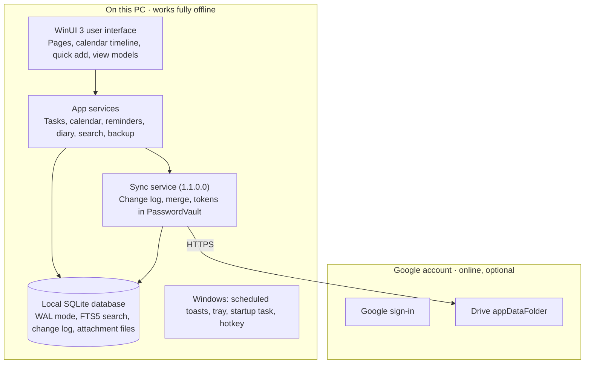

# My To-Do : Daily Planner — Requirements & Implementation

As of 13 November 2026

> Version scope: 1.0.0.0 contains everything below except Google sign-in and sync (SYN-01–10) and backup and restore (SET-01–02), which ship in 1.1.0.0. See [development-plan.md](development-plan.md).

## 1. Overview

My To-Do : Daily Planner is a native Windows app that combines a to-do list, a calendar with time blocking, reminders and a work diary, with all data stored locally on the device. Google sign-in is optional and used only to sync data to the user's own Google account.

**Product vision.** One fast, private place on the work laptop to plan the day, block time for tasks and meetings, get reminded, and record what happened.

**Goals**

- Plan the day in under 2 minutes: capture tasks, drag them onto the calendar, done.
- Never miss a reminder, even when the app window is closed.
- Feel like a built-in Windows 11 app: Fluent design, native controls, instant response.
- Keep every feature working with no internet connection.
- Sync to the user's Google account without any other server.

**Target user.** A single professional using one Windows work laptop, who wants a personal planner and diary that is not tied to a company or third-party cloud service.

**Glossary**

| Term | Meaning |
| --- | --- |
| Task | A to-do item with optional due date, reminder, priority and list |
| Time block | A slot on the calendar reserved for a task or focus work |
| Event | A meeting or appointment with start and end time |
| Diary entry | One rich-text journal page per day |
| Sync | Copying local changes to and from the user's Google account |

## 2. Scope and constraints

Version 1.0 covers tasks, calendar, reminders, diary and Google sync on a single Windows PC; mobile apps and team sharing are out of scope.

**Core principles**

1. **Native UI.** WinUI 3 controls only; no web views, Electron or cross-platform UI frameworks.
2. **High performance.** Instant launch, instant search, no visible lag when scrolling or dragging.
3. **Offline-first.** Every feature works without internet. The network is used only for Google sign-in and sync.
4. **Private by default.** No telemetry, analytics, ads or third-party servers. Data leaves the device only to the user's own Google account.

**In scope**

- Tasks, lists, tags, subtasks, recurrence, priorities, file attachments, archiving
- In-app calendar (day/week/month) with time blocking, kept entirely inside the app
- Native Windows reminders that fire when the app is closed
- Daily diary / work log
- Weekly insights: tasks completed vs time spent
- Tray icon, startup launch, global quick-add hotkey
- Optional Google sign-in and sync to Google Drive app data, including restore after reinstall (1.1.0.0)
- Local backup, import and export (backup and restore in 1.1.0.0)

**Out of scope**

- Any Google Calendar access: nothing is read from or written to Google Calendar
- Outlook / Microsoft 365 / Teams calendar integration
- Importing from other to-do apps
- Mobile, macOS or web clients
- Sharing or assigning tasks to other people
- AI scheduling or cloud-based assistants
- App or diary lock (Windows Hello), local database encryption
- Languages other than English
- Multiple user accounts on the same install

**Platform constraints**

- Windows 10 version 1809 or later and Windows 11, both fully supported.
- Distributed through the Microsoft Store as a signed MSIX package.
- One user per installation. Sync also restores all data when the app is reinstalled or moved to a new PC.

## 3. Market analysis

Popular planners are cloud-first and need an account on the vendor's servers; none combines native Windows UI, fully local data and Google as a private sync backend.

| App | Strength | Gap for this product |
| --- | --- | --- |
| Microsoft To Do | Free, simple, "My Day" daily list | No time blocking; requires Microsoft account and cloud |
| TickTick | Tasks, calendar views, Pomodoro, habits, Google Calendar sync | Cloud account required; full calendar is paid |
| Todoist | Fast capture, natural-language dates | Weak time blocking; cloud-first |
| Akiflow | Tasks plus calendar time blocking, daily planning ritual | Costly subscription; cloud-first |
| Morgen | Merges many calendars with tasks from other tools | Subscription; cloud-first |
| Motion / Reclaim | AI auto-scheduling into calendar gaps | Web and cloud only |

**Features adopted from the market:** a "Today" daily plan view (Microsoft To Do), natural-language quick add (Todoist), drag a task onto the calendar to block time (Akiflow, TickTick), and an end-of-day review (Akiflow).

**Differentiation**

- Truly native WinUI 3 app with Windows-level performance and look.
- Fully offline; no vendor account, no subscription.
- Sync goes only to the user's own Google account.
- Built-in diary linked to each day's tasks and meetings, which most task apps lack.

Further reading: [Efficient App: best to-do apps](https://efficient.app/best/todo-list), [Morgen: Todoist vs Microsoft To Do](https://morgen.so/blog-posts/todoist-vs-microsoft-to-do), [Zapier: best Windows to-do apps](https://zapier.com/blog/best-windows-to-do-list-apps/).

## 4. Functional requirements

Requirements are grouped by module; priority uses MoSCoW (Must, Should, Could), and every Must is required for v1.0.

### 4.1 Tasks

| ID | Requirement | Priority |
| --- | --- | --- |
| TSK-01 | Create, edit, complete and delete tasks with title, notes, due date/time, priority (P1–P4) and list | Must |
| TSK-02 | Organize tasks into user-defined lists, with an Inbox as the default list | Must |
| TSK-03 | Add tags to tasks and filter by tag | Must |
| TSK-04 | Subtasks (one level) with their own completion state | Must |
| TSK-05 | Recurring tasks: daily, weekdays, weekly on chosen days, monthly by date or weekday (e.g. 2nd Monday), yearly, every N days after completion | Must |
| TSK-06 | Smart views: Today, Upcoming (7 days), Overdue, No date, Completed, Archive | Must |
| TSK-07 | Quick add with natural-language parsing of date, time, priority and tag (e.g. "Review PR tomorrow 3pm p1 #projectX") | Should |
| TSK-08 | Drag-and-drop reorder within a list and move between lists | Should |
| TSK-09 | Attach files to a task: files are copied into the app's own storage, can be opened, renamed and removed, and sync with the task; maximum 10 MB per file | Must |
| TSK-10 | Undo the last delete or complete action for 10 seconds | Should |
| TSK-11 | Completed tasks move to Archive automatically after a configurable period (default 30 days); archived tasks stay searchable and can be restored | Must |
| TSK-12 | Track time spent on a task with a Start / Stop timer (one timer running at a time, visible in the title bar and tray), by manual entry, or from completed time blocks; the timer keeps running if the window is closed | Must |

### 4.2 Calendar and time blocking

The calendar is the app's own calendar; it is never connected to Google Calendar or any other calendar service.

| ID | Requirement | Priority |
| --- | --- | --- |
| CAL-01 | Day, week (7-day and work-week) and month views | Must |
| CAL-02 | Create events (meetings, appointments) with title, start, end, location, notes, color | Must |
| CAL-03 | Drag a task from the task pane onto the calendar to create a time block linked to that task | Must |
| CAL-04 | Drag to create, move and resize events and blocks in 15-minute steps | Must |
| CAL-05 | Event types: Meeting, Focus block, Personal, each with its own color | Must |
| CAL-06 | Recurring events with the same rules as TSK-05, and edit "this / all following / all" | Must |
| CAL-07 | Overlap warning when a new block conflicts with an existing event | Should |
| CAL-08 | Mark a block done; completing a block adds its duration to the task's time spent and offers to complete the task | Must |
| CAL-09 | Export events to an .ics file on disk (local only) | Could |
| CAL-10 | Configurable working hours and first day of week | Must |

### 4.3 Reminders and notifications

| ID | Requirement | Priority |
| --- | --- | --- |
| REM-01 | Native Windows toast reminders for tasks and events | Must |
| REM-02 | Reminders fire even when the app is closed or minimized | Must |
| REM-03 | Items with a start or due time: default reminders 1 hour, 30 minutes and 15 minutes before, each switchable on/off per item; custom offsets and "at start time" can be added | Must |
| REM-04 | Tasks with a due date but no time: default reminders at 3:00 pm the day before and 9:00 am on the due date | Must |
| REM-05 | Short-notice items: any reminder whose time has already passed when the item is saved is skipped; if all have passed, one reminder fires at start time | Must |
| REM-06 | Toast buttons: Snooze (5 min, 15 min, 1 hour, tomorrow 9 am) and Mark done | Must |
| REM-07 | After sleep, shutdown or missed reminders, show a single summary of missed items on next launch | Must |
| REM-08 | Reminder sound on by default; choose from Windows notification sounds or silent | Must |
| REM-09 | Daily planning prompt at a chosen time (e.g. 9:00 am: "Plan your day") | Should |
| REM-10 | Respect Windows Do Not Disturb / Focus settings | Must |

### 4.4 Diary / work log

| ID | Requirement | Priority |
| --- | --- | --- |
| DIA-01 | One diary entry per day with rich text (bold, italic, lists, headings, links) | Must |
| DIA-02 | Diary page shows that day's completed tasks and meetings alongside the entry | Must |
| DIA-03 | Auto-generated end-of-day summary: completed, slipped, time spent per list | Should |
| DIA-04 | Browse entries by calendar and search across all entries | Must |

### 4.5 Windows integration

| ID | Requirement | Priority |
| --- | --- | --- |
| WIN-01 | System tray icon with menu: Quick add, Open, Today, Sync now, Exit | Must |
| WIN-02 | Option to launch at Windows startup, minimized to tray | Must |
| WIN-03 | Global hotkey for quick add (default Win+Shift+T, configurable) | Should |
| WIN-04 | Follow system light/dark theme and accent color; Mica backdrop on Windows 11, solid fallback on Windows 10 | Must |
| WIN-05 | Full keyboard navigation and shortcuts (Ctrl+N new task, Ctrl+F search, Ctrl+1–5 switch views) | Must |
| WIN-06 | Taskbar jump list: New task, Today, Calendar | Could |
| WIN-07 | Closing the window keeps the app running in the tray (configurable) | Must |

### 4.6 Google account and sync (1.1.0.0)

Sign-in and sync are completely optional; without them the app works fully and data stays only on the PC.

| ID | Requirement | Priority |
| --- | --- | --- |
| SYN-01 | Optional Google sign-in through the system browser; the app is fully usable without it | Must |
| SYN-02 | Sync all data (tasks, lists, events, diary, attachments, settings) to the user's Google Drive app-data folder only | Must |
| SYN-03 | "Sync now" button always available (main window and tray) | Must |
| SYN-04 | Automatic sync interval configurable in Settings: Off, 15 min, 30 min, 1 hour, 4 hours (default 30 min); option to sync on app start | Must |
| SYN-05 | Restore after reinstall: signing in on a new or empty install downloads all data, including attachments, from Drive | Must |
| SYN-06 | If both the PC and Drive already hold data at first sign-in, merge them rather than overwrite | Must |
| SYN-07 | Offline changes queue locally and sync when the connection returns | Must |
| SYN-08 | Conflict resolution: last-write-wins per field; diary text keeps both versions | Must |
| SYN-09 | Show sync status (last synced time, pending changes, errors) in the status bar | Must |
| SYN-10 | Sign out keeps local data; option to delete the cloud copy | Must |

### 4.7 Settings, backup and data

| ID | Requirement | Priority |
| --- | --- | --- |
| SET-01 | Automatic daily local backup, keeping the last 3 days (1.1.0.0) | Must |
| SET-02 | Manual backup and restore from file (1.1.0.0) | Must |
| SET-03 | Export all data to JSON; export calendar to .ics | Must |
| SET-04 | Settings for theme, startup, hotkey, working hours, default reminders, reminder sound, sync interval, archive period, attachment size limit | Must |
| SET-05 | Full-text search across tasks, archive, events and diary from one search box | Must |

### 4.8 Insights

| ID | Requirement | Priority |
| --- | --- | --- |
| INS-01 | Weekly report: tasks completed vs time spent for the selected week | Must |
| INS-02 | Breakdown of completed tasks and time spent per list and per tag | Must |
| INS-03 | Trend chart of the last 8 weeks: tasks completed and hours spent | Should |
| INS-04 | Planned (time blocked) vs actual time spent per week | Should |
| INS-05 | Export the weekly report to CSV | Could |

## 5. Non-functional requirements

The app must launch in under 1 second warm and stay under 150 MB of memory with 10,000 tasks, while working fully offline.

### 5.1 Performance

| ID | Target | Measured on |
| --- | --- | --- |
| PRF-01 | Cold start to usable window ≤ 2.0 s; warm start ≤ 1.0 s | Mid-range laptop (4-core CPU, 8 GB RAM, SSD) |
| PRF-02 | Quick-add window appears ≤ 200 ms after hotkey | App running in tray |
| PRF-03 | Search results ≤ 100 ms across 10,000 tasks and 1,000 diary entries | Same |
| PRF-04 | Switching views (Today, Week, Month) ≤ 150 ms | Same |
| PRF-05 | Scrolling and drag on calendar at 60 fps, no dropped frames during drag | Same |
| PRF-06 | Memory ≤ 150 MB in use, ≤ 60 MB idle in tray | Same |
| PRF-07 | Idle CPU ≈ 0% when minimized; no polling loops | Same |
| PRF-08 | Install size ≤ 80 MB | MSIX package |

### 5.2 Offline and reliability

- Every feature except sign-in and sync works with the network disabled.
- No data loss on crash or power cut: database in WAL mode, every edit committed immediately.
- A failed sync never blocks the UI and never deletes local data.
- Reminders survive app restarts, Windows restarts and app updates.

### 5.3 Security and privacy

- No telemetry, analytics, crash upload or ads. Optional local log file only.
- Network calls only to Google sign-in and Google Drive endpoints, and none at all while signed out.
- OAuth refresh token stored in Windows PasswordVault; never written in plain text.
- Google scopes: `drive.appdata` for sync, plus `openid` and `email` to show the signed-in account. No Calendar, Gmail or full-Drive scopes.
- Plain SQLite database (no encryption) in the app's per-user local folder, protected by Windows account permissions.
- A public privacy policy page is published, as the Microsoft Store requires for apps that sign in and use the internet.

### 5.4 Usability and accessibility

- Follows Windows 11 Fluent design guidelines and standard WinUI 3 controls.
- Screen reader support (Narrator) with labels on all controls.
- Full keyboard access; visible focus states.
- Works at 100%–200% display scaling and in high-contrast mode.
- Text scales with the Windows text-size setting.

### 5.5 Compatibility and maintainability

- Windows 10 1809+ and Windows 11, x64 and ARM64.
- Database schema versioned with automatic migrations.
- Unit test coverage ≥ 70% on domain and sync logic.

## 6. UI/UX

The main window uses a left NavigationView with seven destinations, a top search box, and a collapsible task pane beside the calendar for drag-to-block. Screen designs for every screen in light and dark themes are in [`/designs`](../designs/index.html).

| Screen | Purpose | Key WinUI controls |
| --- | --- | --- |
| Today (home) | Today's tasks on the left, today's timeline on the right; plan the day by dragging tasks into slots | ListView, custom DayTimeline, InfoBar for missed reminders |
| Lists | Inbox, user lists and Archive, with tags and filters | NavigationView items, ListView with grouping, CommandBar |
| Calendar | Day / Week / Month views with task pane | Toggle buttons, custom week grid, month grid |
| Diary | Day's entry, with that day's completed tasks and meetings | RichEditBox, CalendarView, Expander |
| Insights | Weekly tasks completed vs time spent, per list and tag, 8-week trend | Native bar charts, grid table |
| Search | Results across tasks, archive, events and diary | AutoSuggestBox, ListView |
| Settings | Account, sync interval, reminders and sound, backup, archive, appearance, startup | Settings rows with toggles and combo boxes |

**Secondary windows and surfaces**

- **Quick add:** small always-on-top window opened by hotkey or tray; one text box with natural-language parsing preview; Enter saves, Esc closes.
- **Task / event detail:** side panel rather than a modal dialog, so the list stays visible.
- **Toast notification:** title, time, list name; buttons Snooze and Mark done.
- **Tray menu:** Quick add, Today, Sync now (1.1.0.0), Exit.

**Design rules**

- Mica backdrop on Windows 11 and a solid themed background on Windows 10; system accent color, Segoe UI Variable (Segoe UI on Windows 10), Fluent icons.
- Single-click to open details; double-click on calendar to create an event.
- Empty states explain the next action (e.g. "No tasks for today. Press Ctrl+N to add one.").
- Minimum window size 900 × 600; below 1,200 px wide, the task pane collapses into a flyout.
- Task detail panel shows attachments as file chips; drag files from Explorer onto a task to attach them.

**Branding**

- **Icon:** a green planner page with two binder rings, a white tick mark, and a small amber sun where the tick's rising stroke ends: the day's tasks done.
- **Colors:** Planner green `#1F8A5B` (gradient `#2FAE72` to `#137447`), ring green `#0E5A37`, sun amber `#F4A62A`, white tick `#FFFFFF`.
- **In-app accent:** planner green is the app accent; the amber sun color is used only for the Today badge and running timer.
- **Store assets from the master SVG:** Square44x44, Square150x150, Wide310x150, Square310x310, StoreLogo 50x50, splash 620x300, plus a 300 × 300 Store logo and a 120 × 120 logo for Google's consent screen.

## 7. Architecture and technology stack

The app is a single packaged WinUI 3 process with four local layers; only the sync service (1.1.0.0) makes network calls, and only after Google sign-in.

| Layer | Technology | Why |
| --- | --- | --- |
| Language / runtime | C#, .NET 10 | Mature, fast, first-class WinUI support |
| UI framework | WinUI 3 on Windows App SDK 2.x | Microsoft's native Fluent UI stack for Windows 11 |
| UI pattern | MVVM with CommunityToolkit.Mvvm | Testable view models, source-generated commands |
| Database | SQLite via Microsoft.Data.Sqlite | Fast, embedded, zero setup |
| Search | SQLite FTS5 | Sub-100 ms full-text search |
| Notifications | Windows App SDK AppNotification + ScheduledToastNotification | Reminders fire with app closed |
| Tray | H.NotifyIcon.WinUI | Native tray icon and menu |
| Win32 interop | RegisterHotKey | Global hotkey |
| Google (1.1.0.0) | Google.Apis.Auth, Google.Apis.Drive.v3 | Official .NET clients |
| Logging | Local rolling file | No remote logging |
| Packaging | MSIX, signed | Clean install, startup task, updates through the Microsoft Store |

**Solution structure**

- `MyTodo.App` — WinUI 3 project: views, view models, tray, hotkey, app startup
- `MyTodo.Core` — domain models, recurrence engine, NL parser, reminder rules (no UI references)
- `MyTodo.Data` — SQLite stores, migrations, FTS, change log
- `MyTodo.Sync` — OAuth, Drive client, merge engine, restore (1.1.0.0)
- `MyTodo.Tests` — unit and integration tests

## 8. Data model

All data lives in one local SQLite database; every syncable row carries a UUID, `updated_at`, `deleted` flag and `version` so changes can be merged across devices.

| Table | Key fields | Notes |
| --- | --- | --- |
| `lists` | name, color, sort_order, is_inbox | One Inbox list always exists |
| `tasks` | list_id, parent_id, title, notes, priority, due, due_has_time, status, completed, archived, sort_order, rrule, repeat_after | parent_id set for subtasks; archived set when moved to Archive |
| `task_tags` | task_id, tag | Many-to-many |
| `attachments` | task_id, file_name, stored_name, size, sha256, mime | File itself lives in the app's attachments folder |
| `events` | title, notes, location, start, end, all_day, kind (meeting / focus / personal), task_id, rrule, exceptions, series_id, done | task_id set for time blocks |
| `reminders` | owner_type, owner_id, kind, offset_min, day_offset, tod_min, enabled | Timed items: 60, 30, 15 min before; date-only tasks: 3:00 pm day before, 9:00 am on the day |
| `time_entries` | task_id, start, end, minutes, source (timer / block / manual), event_id | Feeds Insights |
| `diary_entries` | date (unique), body (RTF), plain | One per day |
| `settings` | key, value | App settings as JSON, plus internal values |
| `change_log` | tbl, row_id, op, version, at, synced | Outbox for 1.1.0.0 sync |
| `reminder_log` | key, state, at | Shown, snoozed, dismissed or done per reminder occurrence |
| `search_index` | FTS5 over tasks, events, diary and attachment file names | Kept up to date on every write |

**Rules**

- Store all times in UTC; display in the Windows local time zone.
- Recurring items store one row plus an RRULE; occurrences are expanded in memory for the visible date range.
- Deletes are soft (tombstones) and purged 30 days after they have synced.
- Attachment files are stored by content hash (`sha256`), so a file is uploaded to Drive only once.
- Device-only data (window size, hotkey, startup) never syncs.

## 9. Implementation approach

The three hardest parts are OS-scheduled reminders, the custom week timeline, and conflict-safe sync.

### 9.1 Reminders

- `ScheduledToastNotification` registered with Windows, so the toast fires even when the app is closed.
- Timed items get the default offsets 60, 30 and 15 minutes before start; date-only tasks get 3:00 pm the day before and 9:00 am on the due date. On save, each offset already in the past is skipped; if all are skipped and the start is still ahead, one reminder is scheduled at start time.
- Any reminder due within the next 7 days is scheduled as soon as the item is saved; on start, hourly and after sleep, the next 7 days are re-registered.
- Toast buttons (Snooze with a choice of times, Mark done, Dismiss) are handled through `AppNotificationManager`; the app does not need to show a window.
- A one-minute heartbeat detects sleep; reminders that should have fired while asleep are shown in one summary (REM-07).

### 9.2 Calendar timeline

- A custom `WeekTimeline` control: a time gutter and one Canvas per day; events positioned by minutes × pixels-per-minute.
- Overlapping events are laid out side by side; overlaps get a warning outline.
- Pointer drag to move and resize with 15-minute snapping; tasks dropped from the task pane become linked focus blocks.
- Only the visible range is loaded; recurring events are expanded in memory for that range only.

### 9.3 Google sign-in (1.1.0.0)

1. Google Cloud project with OAuth client type **Desktop app**, Drive API only.
2. System browser with PKCE and a loopback redirect (`http://127.0.0.1:<random port>`).
3. Refresh token in `PasswordVault`; access tokens in memory only.
4. Consent screen in **Production** (Testing status expires refresh tokens after 7 days).
5. Scopes: `drive.appdata`, `openid`, `email`.

### 9.4 Sync engine (1.1.0.0)

1. **Record:** every local write also inserts a row in `change_log` in the same transaction (already in 1.0.0.0).
2. **Push:** unsynced changes batched into compressed JSON change files in the Drive app folder; attachments uploaded once by hash.
3. **Pull:** download change files from other devices newer than this device's cursor, apply in order.
4. **Merge:** last-write-wins per field; tombstones win over older edits; diary text conflicts keep both versions.
5. **Compact:** weekly snapshot; older change files deleted.
6. **Restore after reinstall:** empty database + sign-in downloads the snapshot, newer changes and attachments.

### 9.5 Search and quick add

- SQLite FTS5 index updated on every write; prefix matching for type-ahead.
- Rule-based offline parser for dates, weekdays, "tomorrow", times, `p1`–`p4`, `#tag`, `@list` and repeat phrases, with a live preview.

### 9.6 Windows integration

- Tray: H.NotifyIcon.WinUI. Startup: MSIX `StartupTask`. Hotkey: Win32 `RegisterHotKey`.
- Single instance: `AppInstance.FindOrRegisterForKey` redirects a second launch to the running app.
- Windows 10 support: Mica on Windows 11, solid themed background on Windows 10.

## 10. Delivery roadmap

See [development-plan.md](development-plan.md) for the schedule, milestones and completion status. 1.0.0.0 goes to the Store on 6 January 2027; 1.1.0.0 (sign-in, sync, backup) on 20 January 2027.

## 11. Testing and acceptance criteria

v1.0 is accepted when every Must requirement passes its test and all performance targets in 5.1 are met on the reference laptop.

| Level | What is tested | Tools |
| --- | --- | --- |
| Unit | Recurrence expansion, NL parser, sync merge, reminder planning | xUnit |
| Integration | SQLite stores, migrations, FTS, Drive upload/download against a test account | xUnit, test Google project |
| UI automation | Add task, drag to calendar, snooze toast, diary entry | WinAppDriver / Appium for Windows |
| Performance | Start time, search time, memory with a 10,000-task seeded database | BenchmarkDotNet, Windows Performance Recorder |
| Manual | Offline mode, sleep/wake, DST changes, two-PC sync conflicts, high contrast, Narrator | Checklist |

**Key acceptance scenarios**

- [ ] With Wi-Fi off and never signed in, every feature works: tasks, calendar, reminders, diary, attachments, insights.
- [ ] A task starting in 2 hours reminds at 1 hour, 30 minutes and 15 minutes before, with sound, even after exiting from the tray.
- [ ] A task starting in 20 minutes: only the 15-minute reminder fires.
- [ ] A task starting in 5 minutes: one reminder fires at start time.
- [ ] A task due tomorrow with no time reminds at 3:00 pm today and 9:00 am tomorrow.
- [ ] Snooze 5 min on the toast; it reappears 5 minutes later without opening the main window.
- [ ] Sleep through a reminder; on wake, the missed-reminder summary appears.
- [ ] Drag a task onto Wednesday 10:00 in week view; a 30-minute linked block is created; marking it done adds 30 minutes to the task's time spent.
- [ ] Start a timer, close the window, reopen 20 minutes later: the timer shows about 20 minutes; Stop adds it to the task and to Insights.
- [ ] Attach an 8 MB PDF, open it, remove it; a 12 MB file is rejected with a clear message.
- [ ] A task completed 31 days ago appears in Archive and is found by search.
- [ ] Insights shows the correct tasks completed and hours spent for a seeded week.
- [ ] (1.1.0.0) Set sync interval to 15 minutes; a change syncs within 15 minutes, and "Sync now" syncs immediately.
- [ ] (1.1.0.0) Uninstall, reinstall from the Store, sign in: all data and attachments return.
- [ ] (1.1.0.0) Edit the same diary day on two installs; both versions are kept with a conflict marker.
- [ ] App passes Windows App Certification Kit and runs on Windows 10 1809 and Windows 11.
- [ ] Network monitor shows no traffic in 1.0.0.0, and in 1.1.0.0 traffic only to Google sign-in and Drive while signed in.

## 12. Risks, assumptions and decisions

| Risk | Impact | Mitigation |
| --- | --- | --- |
| Tight schedule against the 16 November target | Features cut or the date slips | Two versions: 1.0.0.0 without sync and backup, 1.1.0.0 two weeks later |
| Google OAuth left in Testing status | Sign-in breaks every 7 days | Publish consent screen to Production before daily use |
| Microsoft Store certification rejects the build | Release delayed | Run the certification kit locally; declare capabilities correctly |
| App name conflict in Microsoft Store | Cannot publish under chosen name | Reserve "My To-Do : Daily Planner" in Partner Center now |
| Attachments fill Google Drive quota | Sync of new files fails | 10 MB per-file limit; warning when Drive is nearly full |
| Custom week timeline takes longer than planned | Calendar milestone slips | Build it first as a spike |
| Windows limits on scheduled toasts | Far-future reminders missed | Rolling 7-day window, re-scheduled on save, on start and hourly |
| Windows 10 lacks some Windows 11 visuals | UI looks different on Windows 10 | Mica only on Windows 11; test on both versions |
| Time zone and DST bugs | Wrong reminder times | Store UTC; dedicated DST tests |

**Decisions**

| Topic | Decision |
| --- | --- |
| Google sign-in and sync | Completely optional; permitted for work data; in 1.1.0.0 |
| Google Calendar | Not used at all; the calendar exists only inside the app |
| Outlook / Teams, import from other apps | Not required |
| Sync timing | "Sync now" plus configurable interval (default 30 min); restore everything from Drive after reinstall |
| Reminders, timed items | 1 hour, 30 minutes and 15 minutes before; with sound |
| Reminders, date-only tasks | 3:00 pm the day before and 9:00 am on the due date |
| Snooze | 5 min, 15 min, 1 hour, tomorrow 9 am |
| Time tracking | Start / Stop timer, manual entry and completed time blocks |
| Local backups | Daily, keep last 3 days; in 1.1.0.0 |
| Database | Plain SQLite, no encryption |
| App lock | None |
| Windows versions | Windows 10 and Windows 11 |
| Distribution | Microsoft Store, public, free |
| Google verification | Brand verification for public sign-in (section 13) |
| Attachments | Required, maximum 10 MB per file |
| Completed tasks | Archived after 30 days |
| Deleted items | Purged 30 days after sync |
| Calendar defaults | 30-minute blocks; working hours 9:00–18:00, Monday–Friday; week starts Monday |
| Reports | Weekly tasks completed vs time spent |
| Language | English only |
| Branding | Green, with a tick-mark icon |
| Releases | 1.0.0.0 without sync and backup; 1.1.0.0 adds them |

## 13. Publishing: Microsoft Store and Google verification

The app is public and free; it needs a Store listing, and for 1.1.0.0 Google brand verification. Both need a homepage and privacy policy hosted on a domain you own.

Because the app uses only non-sensitive Google scopes (`openid`, `email`, `drive.appdata`), it needs Google **brand verification** only, not sensitive-scope review or a security assessment. Google's estimate for brand verification is 2–3 business days, and Microsoft Store certification typically takes up to 3 business days ([Google: brand verification](https://developers.google.com/identity/protocols/oauth2/production-readiness/brand-verification), [Google: Drive API scopes](https://developers.google.com/drive/api/guides/about-auth), [Microsoft: certification FAQ](https://learn.microsoft.com/en-us/windows/apps/publish/faq/microsoft-store-policies-and-resources)).

### 13.1 Prepare a website (needed by both)

1. Get a domain you own, or a static site you can prove ownership of.
2. Publish two pages over HTTPS: a homepage describing the app, and the privacy policy ([PRIVACY.md](../PRIVACY.md)).
3. Verify ownership of the domain in Google Search Console, signed in with the same Google account that owns the Cloud project.

### 13.2 Google Cloud and brand verification (1.1.0.0)

1. In Google Cloud Console, create a project named "My To-Do Daily Planner" and enable the **Google Drive API** only.
2. Open **Google Auth Platform → Branding**: app name exactly as in the Store, support email, 120 × 120 px logo, homepage URL, privacy policy URL, authorized domain, developer contact email.
3. Open **Audience**: user type **External**, then **Publish app** so the status is **In production**.
4. Open **Data access** and add only `openid`, `email` and `.../auth/drive.appdata`.
5. Open **Clients** and create an OAuth client of type **Desktop app**.
6. Open **Verification Center** and submit for brand verification.
7. Reply to any email from Google's Trust & Safety team the same day to avoid delays.
8. After approval, the consent screen shows the app name and logo.

### 13.3 Microsoft Store submission

1. In Partner Center, **Apps and games → New product → MSIX or PWA app**; reserve "My To-Do : Daily Planner".
2. In Visual Studio, **Publish → Associate App with the Store**.
3. Build a Release `.msixupload` for x64 and ARM64; run the **Windows App Certification Kit**.
4. Create the submission: free, all markets, public; category Productivity; age rating; package; listing with screenshots (1366 × 768 or larger); certification notes.
5. Submit; fix any issues in the report and resubmit.
6. After certification, publish; the listing usually appears within a few hours.

## 14. Privacy policy

See [PRIVACY.md](../PRIVACY.md).
